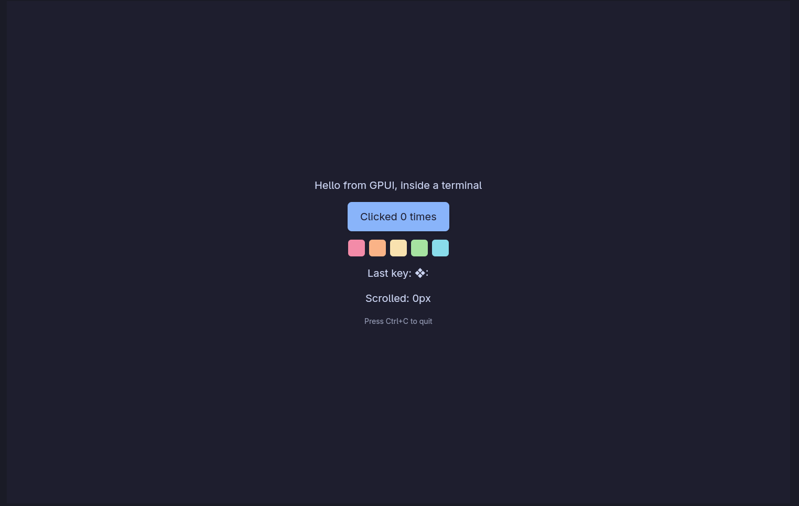

# gpui-tui

Run any [GPUI](https://gpui.rs) app inside a terminal.

gpui-tui is a GPUI platform: instead of opening a desktop window, it renders
each frame offscreen and shows it in the terminal as an image through the
[kitty graphics protocol](https://sw.kovidgoyal.net/kitty/graphics-protocol/).
Keyboard and mouse input from the terminal goes back to GPUI. The app's code
stays the same; only the platform it starts with changes.



*The `hello` example running in Ghostty.*

## How it works

1. GPUI lays out and paints the window as usual, producing a `Scene`.
2. `gpui-pre-wgpu`'s headless renderer draws the scene into a GPU texture
   and reads the pixels back.
3. The frame goes to the terminal as a kitty graphics image. Locally it is
   passed through POSIX shared memory. When the terminal cannot read shared
   memory, it is sent inline (zlib-compressed and base64-encoded).
4. Terminal input (keys through the kitty keyboard protocol, SGR mouse with
   pixel coordinates, bracketed paste, focus, and resize reports) becomes
   GPUI input events.

Frames are only rendered when GPUI asks for one. They are capped at 60 per
second, and the terminal's acknowledgements make sure no more than two
frames are in flight. An idle app sends nothing and uses no CPU.

## Requirements

- **Linux.** Other platforms are not supported yet.
- **[kitty](https://sw.kovidgoyal.net/kitty/) or [Ghostty](https://ghostty.org).**
  gpui-tui checks at startup that the terminal supports kitty graphics, and
  exits with an error otherwise.
- **A GPU, or Mesa's software renderer.** Rendering uses wgpu (Vulkan or GL).
  Mesa's llvmpipe also works without a GPU.
- **Rust 1.98** or newer.

## Try it

```sh
cargo run -p gpui-tui --example hello
```

Run it inside kitty or Ghostty. Click the button, type, scroll, and resize
the window; press Ctrl+C to quit.

## Use it in your app

Add gpui-tui behind an optional feature, so that desktop builds do not include
it:

```toml
[dependencies]
gpui-tui = { git = "<gpui-tui repository URL>", tag = "v0.1.0", optional = true }

[features]
tui = ["dep:gpui-tui"]
```

Then pick the platform at startup:

```rust
use std::ffi::OsString;

/// The application to run, plus the command-line arguments without `--tui`.
#[cfg(feature = "tui")]
fn application() -> (gpui::Application, Vec<OsString>) {
    // `--tui` (or GPUI_TUI=1) selects the terminal.
    let (use_tui, args) = gpui_tui::take_tui_flag(std::env::args_os());
    let app = if use_tui {
        gpui_tui::application()
    } else {
        gpui_platform::application() // or gpui_kit::application()
    };
    (app, args)
}

#[cfg(not(feature = "tui"))]
fn application() -> (gpui::Application, Vec<OsString>) {
    (gpui_platform::application(), std::env::args_os().collect())
}

fn main() {
    let (app, args) = application();
    app.run(move |cx| {
        // Unchanged: open windows, use `args`, ...
    });
}
```

`take_tui_flag` removes `--tui` from the arguments, so an app that reads
positional arguments does not mistake it for one of its own.

- `gpui_tui::application()` exits with an error message if the terminal is
  not supported.
- `gpui_tui::try_application(options)` returns the error instead, and takes
  an `Options` value for configuring it from code.

[Qwerio](https://github.com/sergionoodles/qwerio) uses gpui-tui this way:
`qwerio --tui`.

### Configuration

| Variable | Meaning | Default |
|---|---|---|
| `GPUI_TUI=1` | Same as `--tui` | Off |
| `GPUI_TUI_SCALE` | GPUI scale factor | `2` if cells are at least 24 px tall, otherwise `1` |
| `GPUI_TUI_TRANSPORT` | `shm` (shared memory) or `direct` (inline) | `shm` when the terminal can read it |
| `GPUI_TUI_MAX_FPS` | Frame rate cap | `60` |
| `GPUI_TUI_LOG` | File to append the app's stdout and stderr to | Captured and printed after exit |

Anything the app prints while it runs would land on top of the image, so
stdout and stderr are redirected for as long as the app runs.

## What maps to what

| GPUI | In the terminal |
|---|---|
| Keyboard | Kitty keyboard protocol: key releases, repeats, and every modifier, including Super |
| Mouse, scroll | SGR mouse reports, at pixel precision where the terminal supports it |
| Window size | The terminal's size, updated live on resize |
| Light or dark appearance | Detected from the terminal's background color, then updated live when the terminal's color scheme changes |
| Window title | The terminal's title, restored on exit |
| Mouse pointer shape | OSC 22 |
| Copy to clipboard | OSC 52, which reaches the system clipboard |
| Paste | The terminal's paste (bracketed paste) is inserted into the focused input |
| File dialogs | A built-in file picker drawn as terminal text (see below) |
| Alerts (`window.prompt`) | GPUI's in-window prompt |
| Multiple windows | A stack: the newest window fills the terminal, the others are hidden |
| Open URL or file | `xdg-open` locally; ignored over SSH |

### File picker

Terminals have no file dialogs, so `cx.prompt_for_paths` and
`cx.prompt_for_new_path` show a text-mode picker in place of the app. Apps
need no changes to get it.

| Key | Action |
|---|---|
| Type | Filter the list (when opening) or set the file name (when saving) |
| ↑ ↓, Page Up/Down, Home/End | Move the selection |
| Enter | Open the selected folder, or pick the selection |
| → / ← | Enter the selected folder / go up |
| Backspace on an empty query | Go up |
| Tab | Mark several entries (when the app allows several) |
| Ctrl+H | Show hidden files |
| Esc | Cancel |

You can also type a path: `/etc/`, `~/notes`, `data/db.sqlite`. To pick a
folder, choose the `./` entry. Saving over an existing file asks for a second
Enter. The mouse wheel scrolls the list, and clicking the selected entry
opens it.

## Why `gpui-pre`

GPUI is developed inside the [Zed](https://github.com/zed-industries/zed)
repository. gpui-tui depends on [`gpui-pre`](https://crates.io/crates/gpui-pre),
which is published to crates.io about once a week as a snapshot of Zed's GPUI
(for example, `gpui-pre` 0.3.9 is `zed@93d7456`). It does not use the
official `gpui` crate, for two reasons:

- **A custom platform needs `gpui-pre`.**
  - In the latest `gpui` release on crates.io (0.2.2), the platform traits
    (`Platform`, `PlatformWindow`, …) are `pub(crate)`, and an `Application`
    can only start with GPUI's own platform. A crate outside GPUI therefore
    cannot provide one.
  - `gpui-pre` makes these traits public, adds
    `Application::with_platform`, and splits the platforms and the wgpu
    renderer into separate crates. Its offscreen renderer
    (`WgpuHeadlessRenderer`) is what gpui-tui renders with.
- **GPUI apps already build on it.** UI kits such as
  [gpui-kit](https://crates.io/crates/gpui-kit) build on `gpui-pre`. An app
  can only contain one GPUI, so gpui-tui uses the same one.

If an official `gpui` release offers the same extension points, gpui-tui can
move to it.

### Supported versions

`gpui-pre` changes its platform traits between releases (0.3.9 added three
required methods), so each gpui-tui release supports exactly the `gpui-pre`
version it was tested with. The app's `gpui-pre` version, often chosen by its
UI kit, must match.

| gpui-tui | `gpui-pre` | Matching gpui-kit |
|---|---|---|
| 0.1.0 | 0.3.9 | 0.7.3 |

A new `gpui-pre` version means a new gpui-tui minor release; fixes for the
same `gpui-pre` are patch releases. A new `gpui-pre` release does not affect
an existing gpui-tui release, because the version is pinned exactly.

To try other versions, run `scripts/check-gpui-versions.sh <version>…`. It
builds and tests a copy of the workspace against each version.

### `bench-support`

`gpui-pre-wgpu` only compiles its offscreen renderer with the
`bench-support` (or `test-support`) feature, so gpui-tui enables
`bench-support`. This also builds benchmarking crates (`criterion`,
`hdrhistogram`) into the binary and turns on GPUI's task-timing counters.
`test-support` is not an option: it replaces GPUI's executor with a
deterministic test scheduler.

Feature unification means any binary that links gpui-tui gets
`bench-support`. Depending on gpui-tui through an optional feature keeps it
out of desktop builds.

## Limitations

- **Linux only, kitty and Ghostty only.** Terminals without the kitty
  graphics protocol are rejected. Running inside tmux or screen does not
  work either.
- **SSH is not supported yet.** Frames can already be sent inline, which is
  what a remote session needs, but bandwidth, frame rate, and software
  rendering on GPU-less servers have not been tuned or tested.
- **The whole frame is resent on every change.** Locally, shared memory
  makes this cheap. A large window still costs a few milliseconds per frame
  to render and read back.
- **The clipboard can only be written.** Terminals rarely let programs read
  the clipboard, so `cx.read_from_clipboard()` returns what the app itself
  last copied. Pasting through the terminal (bracketed paste) does work.
- **Scale is a guess.** Terminals do not report display density, so the
  scale factor comes from the cell height. Set `GPUI_TUI_SCALE` if the UI
  looks too small or too large.
- **No IME, native menus, or credential storage.** Input methods are not
  supported, `set_menus` does nothing (apps need in-window menus), and the
  credential APIs return errors.
- **One visible window.** Additional windows stack on top of each other and
  cannot be shown side by side. Window controls (minimize, maximize,
  fullscreen) are not available.
- **Restoring the terminal.** It is restored on normal quit, Ctrl+C, and
  panics, but not after `SIGTERM` or `std::process::exit`. If it is left
  in a bad state, run `reset`.
- **Ctrl+C quits** when the app does not handle it. This can be turned off
  with `Options::quit_on_unhandled_ctrl_c`.

## Project layout

| Crate | Purpose |
|---|---|
| `gpui-tui` | The GPUI platform, window, and event loop |
| `gpui-tui-term` | Terminal I/O without GPUI: capability probing, input parsing, the kitty graphics encoder, terminal restore, and the file picker |
| `gpui-tui-testterm` | A fake kitty-compatible terminal for end-to-end tests: it runs the app on a pseudo-terminal, decodes its frames, and sends it input |

## Development

```sh
cargo fmt --all --check
cargo clippy --workspace --all-targets -- -D warnings
cargo test --workspace
```

The end-to-end tests (`crates/gpui-tui/tests/terminal.rs`) run a real GPUI
app inside the fake terminal. They cover clicks, typing, resizing, the file
picker, shared memory and inline frames, idle CPU use, and terminal restore.
They need a GPU or Mesa.

## License

[MIT](LICENSE)
